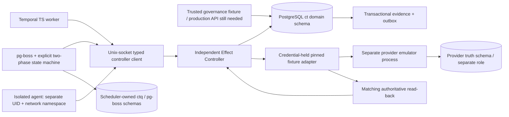

# CONTINUUM — Target Validation & Implementation Results

**Verdict: safety-critical local implementation built and tested; production qualification and final scheduler selection remain BLOCKED.** This is not a claim that the entire end-to-end product has been implemented. No production system, provider account, GitHub branch or canon was changed.

The owner-approved <mention url="https://app.notion.com/p/7bd290b71bbc4b2ba29b3dd5b4277974">Architecture Reconciliation & Synthesis</mention> is the **provisional target**. Broad architecture ideation remains closed. The work followed M1 → M2 → M3 → M4 → M5; tests refined an implementation defect, not the architecture's responsibility split. [^https://app.notion.com/p/7bd290b71bbc4b2ba29b3dd5b4277974]

## 1. Executive result

- **Built:** an additive PostgreSQL 17 foundation, an independent Effect Controller, scoped capability transport, explicit authority/approval/fence checks, effect read-back and UNKNOWN handling, append-only transactional evidence, outbox, and both real scheduler adapters.
- **Tested from fresh fixtures:** 26 Node test groups; five workload cases per scheduler; two Python legacy entry-point guards; blocked logical restore and abrupt local database recovery. All implemented local tests passed on the final revision. These are grouped tests, not 38 production release gates.
- **Fixed during development:** minimal row-lock permission gaps, a final-send expiry race, recovery-capability fencing and monotonic authority versions.
- **Prepared:** fail-closed patches for the demonstrated unsafe legacy paths. They intentionally stop old execution; they are **not applied** to deployed repositories or production.
- **Not decided:** the final production scheduler. Both satisfy the bounded experiment. A 1.2-second timer and retained-v1 replay cannot substitute for a real long-wait/upgrade/operating-cost qualification.
- **Not cleared:** live provider verification, cloud/VM containment, long-lived machine authentication/renewal, HA/PITR/regional recovery, full memory/artifact services, independent review and migration canary.

## 2. Sequential M1–M5 gate record

| Stage | Implemented and exercised | Honest status / exit not yet met |
| --- | --- | --- |
| M1 — safety contract | Seven frozen contracts, state semantics, lock order, honest revocation/UNKNOWN/verification/restore promises; hashed before M2 | **FROZEN for validation revision**, not canon. Production action/verification contracts and owner policies still required |
| M2 — PostgreSQL foundation | Composite tenant keys; FORCE RLS; non-owner roles; immutable operation binding; expected-version state changes; locked evidence head; atomic outbox; blocked logical restore; immediate database restart | **LOCAL PASS / production PARTIAL**. Local trust auth is test-only. HA, continuous WAL/PITR and regional fencing not qualified |
| M3 — Effect Controller | Separate process, credential custody, operation-scoped capabilities, explicit approvals, online authority, final-send recheck, no uncertain resend/fallback, authoritative fixture read-back | **LOCAL PASS / production PARTIAL**. Real issuer/approval UI, capability renewal, provider adapters and managed VM enforcement not implemented |
| M4 — paired scheduler spike | Same database/controller/provider contract; ten-operation branch/wait job; old-version retained replay; partial-job blocking; worker SIGKILL after effect; DB outage; new v2 work | **BOUNDED LOCAL PASS**. Required long-wait/host/native-deployment/scale/economics tests remain incomplete |
| M5 — final scheduler selection | Measured results preserved, no fabricated scores/winner | **HELD**. Do not activate a production scheduler or progress to effectful migration canary from this evidence |

A local baseline of M2/M3 was tested before the scheduler comparison. The final source was then tested again from freshly created fixture databases after the race/fence corrections. Later local release checks do not turn missing production gates green.

## 3. Frozen safety contracts

`docs/M1-SAFETY-CONTRACTS.md` remains unchanged from its pre-M2 freeze.

**SHA-256:** `02b04d213721067464686e7a14c9c7533e506d3c9854505d8eb0fca0864d86ae`.

1. **Identity:** stable operation ID and provider key; canonical full action binding/digest; changed payload is a conflict/new approved operation. Retries never allocate a new effect identity.
2. **Grants/approvals:** exact tenant/principal/action/resource/expiry/version/epoch/generation/cost constraints; independently approved exact digest; AWAITING_APPROVAL is not approval. This implementation deliberately rejects unsupported delegation/wildcards.
3. **Revocation:** serialized authority/admission and final recheck. No later admission after revoke; previously admitted/in-flight effects may still finish. No invented global recall guarantee.
4. **UNKNOWN:** reservation before I/O; crashes/timeouts/uncertain replies keep a possible effect uncertain. No UNKNOWN-to-send transition or alternate transport fallback.
5. **Verification:** matching provider read-back, not an accepted HTTP response/model statement/signature/worker assertion. Missing or inconsistent read-back remains UNKNOWN.
6. **Tenants:** composite FKs, forced RLS and actual non-owner roles; demonstrated tenant reader identity derives from session_user, not a writable GUC. Untrusted agents receive no SQL/provider-wide secret.
7. **Evidence:** head-row locking, contiguous hash links, immutable runtime records and atomic effect/evidence/outbox transitions. Chain validity alone is not external truth.

Restore omits the activation/fence record, so a restored instance cannot simply dispatch. Budget reservations serialize, remain conservative under uncertainty, and are not yet a real billing system.

## 4. Implemented topology and state ownership

**Implemented trust separation:** the controller/provider processes retain fixture secrets in private files; the untrusted test agent gets only one operation-scoped capability. Its namespace cannot reach provider/DB TCP or the protected PostgreSQL Unix socket, and its UID cannot read the controller secret file. A typed request accepts only an allowed operation reference, not an arbitrary URL, tenant, approval flag, completion assertion or provider credential.

**Limits:** this is one local isolated-agent fixture, not a certification of production multi-tenant VM isolation or all workflow workers. Root/DB/controller compromise remains a different trust threat. There is no privileged browser or production cloud network to certify here.

| Owner | Owns | Does not own |
| --- | --- | --- |
| `ct` PostgreSQL domain | Principals/epochs/generations, grant/approval bindings, immutable operations, budget reservations, observation/outcome, context facts, evidence/outbox | Provider reality or scheduler execution history |
| Temporal | Workflow history, timers, signals, activity progression | Grants or permission to replay an UNKNOWN effect |
| `ctq` + pg-boss | Explicit bounded-job phase/cursor/lease, scheduling outbox and delivery/retry state | Domain effect truth or authority |
| Provider emulator | Independent committed effect ledger, with no unique-key dedup hiding duplicate sends | Production SaaS consistency guarantees |
| Context reader | Version/digest-checked tenant data | Authorization facts |

Exact measured versions: Node **24.14.1**, PostgreSQL **17.10**, Temporal TypeScript SDK **1.24.0**, pg-boss **12.37.1**, `pg` **8.23.1**, TypeScript **5.9.3**. Versions are pinned in the dependency lock. The Temporal service was a local CLI dev service; it was not Temporal Cloud or a production HA service.

## 5. Foundation and controller behavior

`migrations/001-foundation.sql` establishes owner/governor/controller/tenant-reader/provider roles, tenant-qualified references, forced RLS, immutable binding/state guards, evidence and outbox. The controller cannot change approval content or grant authority; it can reserve cost and record the outcome. Tenant readers cannot become controller or switch identity using `app.current_tenant`.

`002-lock-privileges.sql` adds non-semantic lock columns because PostgreSQL row locking needs UPDATE privilege on some column. This allows locks without granting the controller permission to edit principal status, approval content or recovery activation fields.

`004-monotonic-fences.sql` rejects decreasing principal epochs/generations or extending/changing grant authority without advancing its version. `003-scheduler-fixture.sql` belongs to scheduler qualification; it does not introduce another authority store.

Execution:

1. Capability authenticates tenant/principal and allowlisted operation ID; it includes deployment fence, epoch/generation and expiry.
2. Controller reads immutable operation, locks recovery control → principal → grant → operation → approval, then reads the current DB clock **after** contended locks.
3. Exact digest/authority/approval/budget checks admit one attempt. Commit reservation, evidence and outbox before I/O.
4. Re-lock/recheck for final SENDING transition. A revoked/expired/stale binding is denied before sending.
5. Pinned trusted adapter sends once; lost reply becomes UNKNOWN. No worker-supplied URL or credential forwarding.
6. Matching authoritative fixture read-back commits outcome/evidence atomically. Missing/mismatched/duplicate observations do not imply success.
7. Duplicate calls return durable state. After an expired possible-send reservation, UNKNOWN is reconciled rather than resent.

The fixture provider deliberately has **no operation-key uniqueness constraint**: an incorrect retry would visibly create another effect. It is a separately committed process/role but shares the local PostgreSQL cluster, so this does not prove independent remote infrastructure durability.

## 6. Actual test results

| Suite | Final result | Evidence file / exercised scope |
| --- | --- | --- |
| PostgreSQL foundation | **7/7** | `evidence/M2-foundation-tests.tap`: roles/RLS, tenant switching, composite FK, role permissions, immutable/state guards, concurrent chain append, rollback |
| Effect Controller | **14/14** | `evidence/M3-controller-tests.tap`: duplicates, approval mismatch, stale scopes/expiry/epoch/generation, revocation, lock-wait expiry, budget, lost ack, three whole-controller kill boundaries, key conflict, false read-back, restore/fence denial, isolated agent, memory and chain integrity |
| Legacy TS guards | **2/2** | `evidence/legacy-typescript-guard-tests.tap`: no SQL/token mint on old effect method; no fake dispatched success from MCP |
| Additional local release checks | **3/3** | `evidence/local-release-gates.tap`: recovery-capability fence, monotonic authority, compute-process/scratch destruction and generation-fenced reconstruction |
| Legacy Python guards | **2 entry points blocked** | `evidence/legacy-python-guard-tests.json`: 503 before database/adapter access; wire/fallback disabled |
| Domain restore | **Blocked by construction** | Activation-control rows are excluded from dump; restored count is zero; controller denies old dispatch. Provider schema excluded |
| Local PostgreSQL crash | **Retained recorded evidence** | `evidence/M2-database-crash.log`: immediate stop/restart and evidence count/sequence equality; not HA/PITR |
| Paired scheduler workloads | **5/5 each** | `evidence/M4-scheduler-results.json`, same target controller/domain; details below |

No Node test was skipped in the final implemented suites. **No production gate is marked PASS_PRODUCTION.** `npm run release-check` deliberately exits nonzero while required evidence is missing.

### Failures discovered and corrected, not hidden

- Initial TS build had a record-shape typing error; corrected before executable controller gates.
- The first controller run exposed missing permissions for PostgreSQL authority row locks. Added only lock-column UPDATE permissions, then recreated fixtures and retested. The failed run is retained.
- Initial Temporal server startup could not use a missing download directory. The harness now creates it; failure is retained as a fixture failure, not a scheduler flaw.
- **A real new-controller race was reproduced:** if a grant expired while the final-send transaction waited for a principal lock, a clock captured before waiting could admit the expired send. The pre-fix probe returned COMMITTED and one local effect when DENIED was required. The correction reads the DB clock after all authority locks; the post-fix probe and final regression deny with zero effects. Pre-fix source/hash and failure log are retained. This was an implementation defect, not evidence to reopen architecture ideation.
- Recovery capabilities now bind deployment fence; principal/grant fences are monotonic. These prevent stale activation assumptions and authority rollback in the tested paths.

## 7. Scheduler comparison and M5 decision

Each engine ran the same ten-operation job: five sequential effects, two parallel branches, a durable timer/human-progress signal, then three effects. The progress signal is **not** a substitute for the controller's independently recorded exact-action approvals.

| Workload case | Temporal | PostgreSQL + pg-boss |
| --- | --- | --- |
| Kill v1 worker while waiting; deploy v2 retaining v1 | DONE, 10 effects; retained v1 history replay succeeds | DONE, 10 effects; persisted v1 input routed by retained handler |
| Revoke first post-wait action | BLOCKED after 7 effects; remaining sends do not happen | Same |
| Crash domain PostgreSQL during wait | New controller request fails closed; resume reaches 10 effects | Same; queue/domain reconnect and resume |
| SIGKILL whole worker after first effect, before scheduler acknowledgement/progress record | Retry uses same ID; DONE, 10 total effects | Same; expired job/lease recovery uses same ID |
| New v2 workload | DONE, 10 effects | Same |

Every inspected operation had at most one provider-emulator effect. A blocked workload had exactly seven pre-wait effects, not a false completed job.

**Measured scope limitations:** the timer is **1.2 real seconds**, not 24 hours. Version upgrade is explicit retention of v1 code plus v2 addition; native Temporal deployment pinning and destructive/incompatible production rollout are not qualified. Controller/worker/database processes were crashed, not an entire machine or region. The full Temporal scheduler service was not fault-injected. Duration samples are functional observations, not statistically controlled latency/cost benchmarks. pg-boss fault recovery waits for its supervision cycle; tuning/operational runbooks matter.

Operational facts, not preference:
- Temporal adds a separate workflow service and replay/retained-version discipline; its worker/workflows use mature durable progression.
- pg-boss uses the existing PostgreSQL service, but the inspected bounded implementation owns a phase table, lease/claim discipline, per-step cursor, scheduling outbox/relay and retained-version routing. This is an explicit two-phase state machine, **not yet a generic homemade workflow engine**.
- Team hours, cloud costs, production request rates, p95 workloads and real recovery toil were not measured. File line counts or one timing sample must not be substituted for these inputs.

**Final production Temporal-vs-pg-boss decision: HELD.** Both are valid for the tested bounded job. No result justifies selecting an unconditional winner for the full target. The provisional Temporal default remains an **unactivated recommendation**, not a measured final selection. M5 remains red until the decisive tests below pass. No third architecture is introduced.

## 8. Complete release-gate ledger — none promoted by a local green run

`docs/RELEASE-GATES.json` and `evidence/RELEASE-STATUS.json` are the machine-readable record.

| Mandatory gate | Current status | Missing evidence that blocks release |
| --- | --- | --- |
| No-bypass | PARTIAL: local UID/network/socket/request tests | Live VM egress/IAM, DNS/redirect/SSRF, browser cookies/CDP and cross-placement isolation |
| Fault/race | PARTIAL: controller/worker/database process kills, contention, duplicates/revocation | All real adapter boundaries, partitions, host loss and broad concurrent races |
| Authority | PARTIAL: exact action, version/fence, approval/expiry/budget | Real identity/approval API, online capability renewal after long waits; delegation unsupported |
| Memory isolation | PARTIAL: tenant data, stale/corrupt digest | Ingestion/retrieval/embedding poisoning, retention/deletion, actual quarantine pipeline |
| Evidence truth | PARTIAL: chains/transactions/matching fixture observation | Live provider contracts, immutable external anchors and retention/redaction |
| Computer destruction/recovery | PARTIAL: isolated process + scratch reconstruction | Actual VM/host destruction, object-store restore, old-host physical credential fence |
| DR | PARTIAL: local crash and blocked logical restore | WAL/PITR/HA, backup-window remote effects, regional fencing and owner RPO/RTO |
| Compromised agent/worker | PARTIAL: local isolated agent | Production worker/VM/multi-tenant identities and credential/network attack tests |
| Resource/spend | PARTIAL: integer reservation and budget serialization | Money/token/provider billing, concurrency/storage quotas and retry-storm limits |
| Scheduler qualification | PARTIAL: five real workloads each | 24-hour soak, native/version/host/service recovery, representative scale/cost/toil |
| Independent security review | NOT RUN | Separate review of trusted controller, credentials, network and provider adapters |
| Migration canary | NOT RUN | Actual deployed revision, approved repository mapping, credential rotation and sole-controller canary |

There are **zero fully passed mandatory production gates**. Partial is not pass. The gate ledger is intentionally stricter than “the tests we happened to write are green.”

### Known implementation gaps, not merely untested claims

The fixture has no production identity/approval API or credential-renewal service. Scheduler job arguments contain short-lived scoped capabilities; workflow-history access must be controlled and a production activity must acquire fresh scope rather than reuse a token after a long wait. The demonstration `ct_scheduler` role can read its entire scheduler-owned job table. **It must not be given to an ordinary untrusted multi-tenant agent/worker**: production task assignment, per-placement/tenant identity and capability custody must contain a compromised workflow worker, not just the isolated-agent fixture. These are known implementation gaps, not inferred passes.

Restore activation is fail-closed, but automatic real-provider backup-window reconciliation is not implemented. There is no full computer/artifact service, production VM policy, live browser adapter or external immutable evidence anchor. Legacy guards stop inspected entry points; they do not assert that every deployed Staxions/tool/credential path has been removed. No complete end-to-end engineering release is claimed.

## 9. Exact files/modules delivered and integration mapping

### New implementation

| File/module | Responsibility |
| --- | --- |
| `docs/M1-SAFETY-CONTRACTS.md` | Frozen binding, authority, revocation, UNKNOWN, verification, tenant and evidence contract |
| `migrations/001-foundation.sql` | Additive domain schema, restricted roles, composite constraints/RLS, immutable states/evidence |
| `migrations/002-lock-privileges.sql` | Non-authority-column row-lock privileges |
| `migrations/003-scheduler-fixture.sql` | Separate scheduler-owned bounded-job projection/outbox |
| `migrations/004-monotonic-fences.sql` | Principal and grant version monotonicity |
| `src/db.ts` | Explicit transactions, canonical binding/hash, head-locked evidence and atomic outbox |
| `src/capability.ts` | HMAC verification/issuance for operation-scoped test capability, including recovery fence |
| `src/controller.ts` | Admission/final recheck, reservations/CAS, provider dispatch, UNKNOWN and read-back reconciliation |
| `src/controller-server.ts`, `src/controller-client.ts` | Narrow Unix-socket operation-reference transport, not generic proxy |
| `src/provider-adapter.ts` | Replaceable adapter contract and **fixture-only** pinned transport |
| `src/memory.ts` | Tenant-role context read with version/digest check; not full memory platform |
| `scheduler/contracts.ts`, `scheduler/effect-activity.ts` | Shared stable operation/job interface; all effects use controller |
| `scheduler/temporal-v1.ts`, `temporal-v2.ts`, `temporal-worker.ts` | Real TS workflows/workers and retained-v1 version strategy |
| `scheduler/pgboss-worker.ts` | Real queue worker, explicit two-phase state, short claim transaction, cursor, scheduling outbox/relay |
| `tests/` | Original, regression, isolation, process-fault, paired workload and local-release harnesses |
| `tools/local-db.sh`, `backup-domain.sh`, `run-validation.sh`, `check-release.py` | Disposable local DB, fail-closed dump/restore fixture, ordered reproducibility and enforced release block |
| `package.json`, `package-lock.json`, `tsconfig.json` | Exact dependencies/build interfaces |

### Existing unsafe files — delivered guards, not deployed changes

The source pins and unsafe behaviors were established in the earlier <mention url="https://app.notion.com/p/980c0eb11815427a9fbe045443bed0a2">Inventory and Validation</mention>. [^https://app.notion.com/p/980c0eb11815427a9fbe045443bed0a2]

| Existing file | Delivered hotfix now | Subsequent implementation |
| --- | --- | --- |
| `Continuum/backend/server.py::dispatch_effect` | HTTP 503 before DB/adapter; disables unsafe route | Forward authenticated stable operation references to the independently qualified controller; stop old sender/rotate credentials before canary |
| `Continuum/backend/adapters/nexus.py::_live_dispatch` | Disabled before wire execution/fallback | Replace with controller-owned qualified NEXUS/provider adapter; no fallback after possible send |
| `continuum2/packages/effect-boundary/src/index.ts` | Explicit failure before SQL/token mint | Replace with narrow controller client; no inline authority/approval fabrication or random provider token |
| `continuum2/apps/api-mcp/src/index.ts` | NOT_ENABLED instead of fake dispatched success | Identity-derived tenant/principal; real admission/workflow start/status response |

These guards address the inspected Mongo redispatch/fencing race and uncertain fallback and the inspected TS approval/dispatch prototype. They intentionally suspend unsafe execution rather than claiming an incomplete inline patch makes it safe. Full-repository build/integration against the actual deployed revision is still required. [^https://github.com/Adaptive-Liquidity/Continuum/blob/9ac4723b5390d22ed2d6aed9cf984cb0a32731ca/backend/server.py#L384-L439][^https://github.com/Adaptive-Liquidity/Continuum/blob/9ac4723b5390d22ed2d6aed9cf984cb0a32731ca/backend/adapters/nexus.py][^https://github.com/Adaptive-Liquidity/continuum2/blob/2501f879a57982edb24e79c30f00f68ccae5a545/packages/effect-boundary/src/index.ts]

The file-level patch is `legacy-hotfixes/FAIL-CLOSED-SAFETY-HOTFIX.patch`; modified copies are alongside it. Historical source/evidence is untouched.

### Exact modules still to build/change before an engineering release

- `src/identity-provider.ts`, `src/governance-api.ts`, `src/approval-api.ts`, `src/capability-renewal.ts`: real OIDC/machine identity, authenticated ownership/approval and scoped renewal. Do not copy the fixture issuer into production. Activities must obtain fresh authority after long waits; static short-lived capabilities in fixture job arguments are not a production renewal strategy.
- `src/providers/<chosen-provider>.ts`, `src/verification/<chosen-provider>.ts`: exact action mapping, authoritative observation, timeout/idempotency retention/partial-result contracts, no arbitrary URL forwarding.
- `src/computers.ts`, `src/artifact-store.ts`, `migrations/005-computers-artifacts.sql`: logical computer/placement records, immutable object manifests, verified reconstruction and broker-enforced placement fence. The local principal-generation/scratch example is only a seed.
- `infra/controller-network/`, `infra/worker-isolation/`, `infra/postgres/`, `infra/secret-custody/`: approved real private endpoints, per-placement identity, egress/IAM and production TLS/auth/keys. No local trust database or world-accessible Unix socket without authenticated scope should be transplanted as cloud configuration.
- `src/context-service.ts`, `src/context-quarantine.ts`, `src/evidence-export.ts`: complete memory provenance/version/quarantine/deletion and independent immutable evidence anchors.
- `tools/restore-and-reconcile.ts`, `infra/backup/`, `tests/provider-chaos/`, `tests/host-dr/`: real PITR/HA/region fence, provider-gap reconciliation and recovery approval.
- `tests/soak/`, `tests/versioning/`, `docs/OPERATIONS-COST-TRIAL.md`: decisive scheduler release trials. Add only required business states; reject scope growth into a proprietary generic workflow engine.
- Existing `continuum2` coordinator/regency/outbox migrations and Staxions computer exec/fs paths: replace authority/state ownership, remove invalid bound SET/revoke SQL and unlocked evidence allocation; route consequential tools through the controller. Do not let old JSON/Mongo stores remain writable authority masters.

These are **proposed exact module paths to implement**, not claims that those files are already delivered.

## 10. Migration-ready sequence from this implementation

1. **Verify real deployment and source pins** before applying a guard. Open reviewed changes in the owner-selected repositories; none was chosen or pushed here. Inventory actual credentials/endpoints/tenant ownership.
2. **Fail-close old execution first**, with a planned maintenance/read-only window. Review the guard patch and behavior intentionally lost. Do not leave a second legacy provider credential path while testing the new sender.
3. **Integrate M2/M3 in non-effectful staging**: production auth/keys/network, normalized computer/artifact schema, real approved provider adapter and verification. Real DB permission/tenant tests must pass there.
4. **Finish M4/M5**: run the same release workload on both schedulers, with raw correctness results and actual ownership burden. Pick one only after hard gates; preserve original criteria/weights, no fabricated scores.
5. **M6 shadow/read-only mapping**: export existing IDs/data, retain principal/computer identity and audit hashes; compare decisions without sending. No naive dual-write authority.
6. **M7 sole-principal canary**: freeze old sender, rotate/re-enrol credentials, advance authority/placement/recovery fences, enable one new controller. Real approved action/read-back/revocation/worker failure must pass. Rollback stops effects; it does not resurrect old credentials.
7. **M8/M9 progressive cutover/retirement**: sole authority home per tenant, reconcile partial/UNKNOWN effects and retain history read-only. Retire old Mongo/JSON writes only after parity and export validation.

**Do not skip M5 or production safety gates to meet a canary date.** Source retirement/naming changes and deployment approval remain separate owner actions.

## 11. Smallest remaining decisive scheduler experiment

Keep the same domain/controller. Use production-grade deployments, not two different effect implementations.

- Run a real **24-hour wait with fresh scoped machine identity/authority on resume**; kill worker/host; prove expired/revoked approval does not act. Fixture capability renewal must be replaced first.
- Start v1 work, deploy genuinely incompatible v2 using each supported retained-version strategy; resume old work. Temporal native worker-deployment/pinning must be exercised if offered, with replay/history lifecycle and Continue-as-New IDs.
- Abruptly stop the scheduling service/host and database primary at phase boundaries; recover from supported HA/PITR. Confirm no duplicate or resurrected authority after recovery.
- Run representative branching/partial jobs against a real **safe** provider verification oracle, including accepted/lost-ack/missing-read-back cases.
- Record implementation/maintenance hours, business-state code owned, service/runbook burden, fault recovery toil, infra/request costs and representative S/M p95 behavior.
- **Select pg-boss** if these jobs remain a small explicit state machine and pass with materially lower ownership burden. **Select Temporal** if the required workload fails bounded recovery/versioning or drives the PG arm into a generic homemade workflow engine. Until those facts exist: held, not guessed.

## 12. Decisions eligible for owner/canon review

**No implementation, scheduler or production-readiness decision is eligible for unconditional promotion while mandatory gates remain partial.** The following policy/invariant decisions are concrete review candidates, not newly declared canon:

- Domain authority/effect truth remains in PostgreSQL, scheduling progression in the selected engine, external truth at the provider.
- Consequential effects use a separately enforced controller/credential boundary; ordinary agents/workers have no provider-wide credential/SQL bypass.
- Immutable stable operation binding and exact approvals; grants/epochs/generations/recovery fences are checked online and monotonically advanced.
- UNKNOWN is a first-class state; retries never silently resend a possible effect, change transport or create a new ID to hide it.
- Honest revocation: later admissions blocked, already-in-flight effects not universally recalled.
- Evidence is attributable/tamper-evident information, never a substitute for authoritative verification.
- Logical restore is disabled until independently fenced and reconciled; scheduler cancellation is not authorization.

The full provisional target remains the PostgreSQL-centered governed agent system with mature scheduling and isolated computers. Only implementation and validation progressed here. **Final scheduler: HELD. Production readiness: NO. Canon promotion: NO.**
