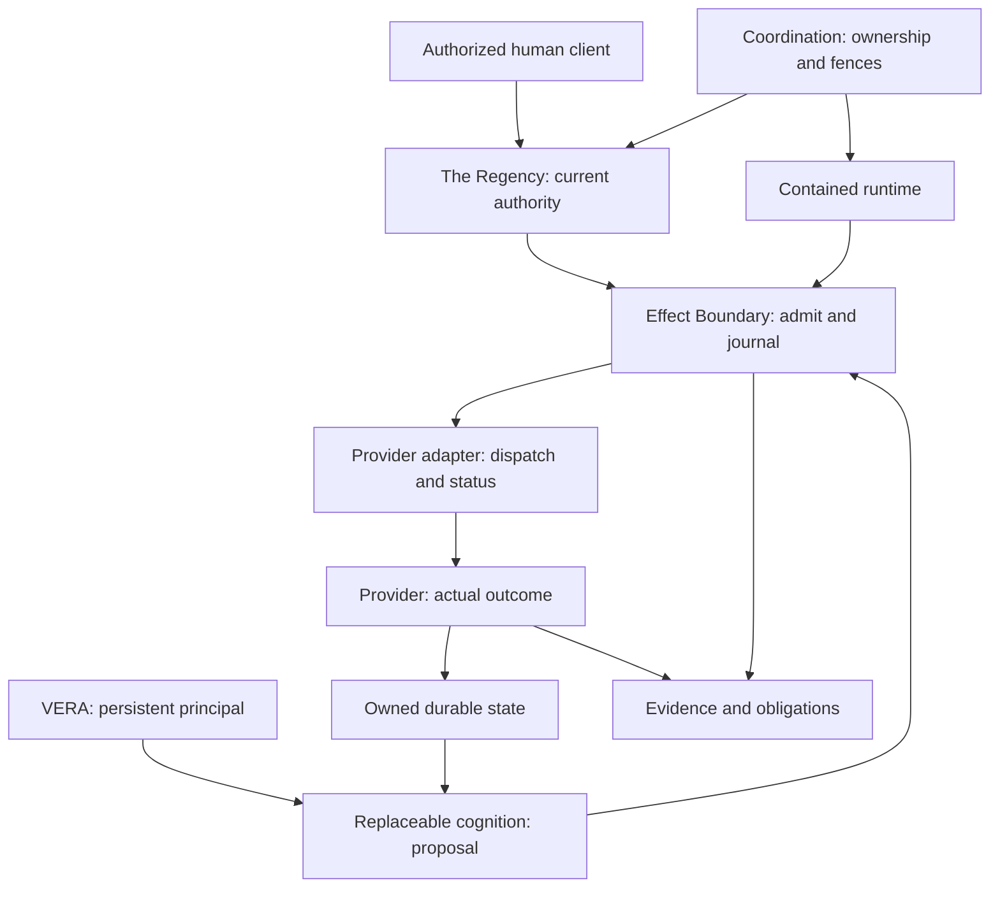

# Asentxia — Master Source of Truth

Private review snapshot: **asentxia-sot-2026-10-02-r1**. Prepared for a unified cross-workspace source. **Not applied to Context7 or any existing source.**

This document consolidates current meanings, architecture, portfolio, bounded evidence, website/brand/launch design, operations/rights requirements, conflicts and handoff. The accompanying ZIP retains the original sources, complete recovered texts, images, machine-readable registries, provenance and validator. It does not contain missing code/raw experimental artifacts or turn plans into proof.

# Current meanings and precedence

Snapshot: **asentxia-sot-2026-10-02-r1**. As of **2 October 2026, 17:23:49 America/Phoenix / 3 October 2026, 00:23:49 UTC**.

**This assembled release is a private review candidate. It has not replaced a repository, Context7 source, prior file, or approval record.** Its approved semantic base is Source of Truth v1, effective 27 September 2026. Source authority is recorded by the recovered archive and CANONICAL_AUTHORITY.md; approval of this new assembled release is not inferred.

Asentxia builds machine-native infrastructure around persistent autonomous principals. Machines operate through structured interfaces and governed effects; humans set mandates, policy, and oversight through authorized clients. The architecture aims to remove unnecessary translation through human navigation. It does not claim that every existing API or OS is human-only, or that every service exposes a direct interface.

**The principal persists. The components may change.**

| Name | Meaning | Evidence boundary |
|---|---|---|
| Asentxia Systems | Institution/company and research institution | Distinct from its products and any standards body |
| DCA | Distributed Cognitive Architecture: Asentxia-defined reference architecture | Definition and obligations, not complete implementation or external industry standard |
| Continuum | Flagship DCA implementation and machine-native operating substrate | Maturity is release/profile-specific |
| VERA | Verifiable Entity with Revocable Authority; persistent autonomous principal | Independent in definition from model, prompt, session, process, credential, runtime, and host; each discontinuity needs evidence |
| Continuum Computer | Persistent logical computing resource | Not one permanent VM or a general migration guarantee |
| The Regency | Governance and organizational product | Mandates, roles, grants, membership, intervention; not the runtime |
| Regency Core | Bounded-authority and organizational-validation engine inside The Regency | Not the whole Effect Boundary |
| Regency Console | Authorized human governance client | Not root authority; not automatically identical to Control Room |
| Effect Boundary | Cross-cutting non-model boundary between proposal and consequential effect | Not an eighth DCA responsibility |
| VERA Collective / Organization | Mission-bound coordination / durable governed institution of distinct VERAs | Defined classes, not proof of production multi-agent implementation |
| VERA Consortium | Optional Organization subtype for a joint enterprise or pooled objective | Optional profile |
| Staxions | Owner-context commercial offering: private cloud computers for AI agents | Personal, Pro, Team, Enterprise (contact us); current availability, pricing, and Continuum integration not inspected |
| CTP | Proposed interconnect profile | Not approved; prototype evidence cannot promote Continuum maturity |
| Provider | Supplier of computers, tools, agents, or services to the ecosystem | No partnership or compatibility claim follows from the definition |

Owner project context supplies **asentxia.com**, **contact@asentxia.com**, and the Staxions spelling. These are intended product/contact references, not live verification of domain, checkout, terms, or deliverability. Founder context identifies Caelin as founder; no biography or corporate-filing claim is added.

## Seven responsibilities

**Environment · State · Authority · Execution · Evidence · Coordination · Cognition Boundary.** These are obligations, not seven required processes, services, databases, or deployment boxes. Principal identity and the Effect Boundary span them.

## Precedence by subject

1. Explicit current owner instructions control this task's scope; they do not supply missing technical evidence.
2. The recovered v1 canon controls approved terminology and relationships.
3. Current claim/evidence records control only the behavior, version, conditions, and authority scope they actually report. A newer plan does not supersede an execution result; a newer result does not redefine canon.
4. Architecture and contract drafts describe design candidates. Research remains within its original versioned scope.
5. Website, press, films, SEO, and launch assets are derived material. Older contradictory variants stay in the archive.

Source of Truth v1 has already resolved the old six-layer taxonomy and retired FLOKS identity. The development master still carries CONFLICT-001 / DEC-001 language around normative taxonomy/governance. Use the approved seven names for company semantics; retain the development decisions as historical/open program records until reconciled in the code program. Do not equate consolidation approval with standardization, licensing, or external adoption.

Controlled maturity: verified, tested implementation, integration, research, corrective. This package additionally records **verification level**: definition, source-reported, artifact-inspected, reproduced, or formal result under assumptions. A copied “verified” badge stays reported unless its artifacts have actually been inspected/reproduced.

Sources: CANON-ZIP; V1-canon/ASENTXIA_CANON.json; V1-canon/CANONICAL_AUTHORITY.md; AUTH-01; ARCH-01; owner project context.

---

# Architecture, state ownership, and draft contracts

The semantic reference is approved for consolidation; the implementation contracts below remain **draft designs extracted from the current program**. No executable API or completed integration is implied.

## Workload and boundary

Initial workload: one principal consumes admitted observations, proposes a bounded task, executes through a safe typed adapter, and retains an unresolved obligation across a runtime handoff. Start with one governance domain and a conventional durable scheduler. Each provider owns its resource state and actual effect outcome. Cognition outputs and retrieved content are untrusted inputs, never authority.

Baseline: typed HTTPS/JSON, established workload identity, ordinary policy engine, relational state, durable workflow/outbox, idempotency/status-capable adapter, bounded execution, and audit records. Rust hot paths, extra stores, consensus, binary encoding, or CTP require a measured workload benefit. Phase 5 and the bounded Phase 7 conventional case keep this baseline a live counterexample.

## Responsibility-to-contract map

| Responsibility | Required contract/behavior | State/authority owner | Remaining evidence |
|---|---|---|---|
| Environment | ComputerSpec, RuntimeBinding, placement lifecycle, CPU/memory/storage/network/IPC limits, deadlines/cancellation | Runtime operator; logical-resource lifecycle governed separately | Hardened containment, overload, shutdown, clean-host restore, tenant isolation |
| State | StateRef, observations, derived memory, checkpoints, retention/invalidation, migration and restore oracle | Named state owner per class | Raw crash/restore evidence, corruption, migration, RPO/RTO, host-loss and retention policy |
| Authority | Mandate, Grant, Decision, Delegation, Approval, Revocation, MembershipChange, EmergencyPause | The Regency / named issuer; resource owner enforces provider boundary | Real issuer lifecycle, skew, distributed revocation ordering, delegation and emergency intervention |
| Execution | Intent, EffectOperation, AdapterCapability, DispatchReceipt, OutcomeQuery, CompensationIntent | Effect boundary owns local journal; adapter owns provider credentials; provider owns effect truth | Real adapter status/retry windows, cancellation after dispatch, compensation, concurrent races |
| Evidence | EvidenceEvent, Query, VerifierInput, integrity/retention metadata | Producer assertion distinct from storage custodian and verifier conclusion | Raw traces and independent verification; tamper/key rotation/retention behavior |
| Coordination | Organization, Membership, TaskLease, FenceToken, Handoff, shared-resource reservation | Governing domain, task owner, one authoritative owner per shared record | Multi-principal task/membership races, stale workers, bounded fan-out, independent custody |
| Cognition Boundary | PrincipalRef, CredentialBinding, CognitionRequest, Proposal, ContextAdmissionDecision, ProviderCapability | Registry owns logical principal; issuer owns credential validity; provider owns model execution | Real cognition substitution and contextual/behavioral evaluation; no arbitrary semantic-equivalence claim |

## Typed vocabulary

Every draft record has an explicit schema/profile version, stable identifier, owner/producer reference, time/deadline semantics, and byte bound. Payload references preserve ownership and provenance. These are contract shapes, not claimed implemented endpoint signatures.

| Record | Core fields/semantics |
|---|---|
| PrincipalRef | principal/VERA ID; governing domain/issuer; lineage/current generation; identity epoch and roots |
| ResourceRef | tenant, provider_id, resource_id, revision, data class |
| StateRef | owner, state class, version, provenance, retention/invalidation |
| Intent | exact action/resource revision, canonical parameters digest, deadline, stable operation/idempotency identity, requested budget |
| Grant / Decision | issuer, subject, audience, scope, ceiling/budget, expiry, policy/revocation epoch; decision binds exact intent digest |
| EffectOperation / ObligationRecord | original downstream operation ID, exact intent, generation, effect state, authenticated status source, retry and compensation rule |
| EvidenceEvent | event/task/operation IDs, producer, sequence, observed time, payload digest, version, retention/integrity metadata |
| ContinuityCapsule | principal/source/target, proposed generation, one-use nonce, expiry, state/authority/obligation/evidence references/digests, compatible profile |
| HandoffRecord | explicit validation, fence, activation and commit state; no implicit reactivation after fencing |
| SkillIR | optional bounded deterministic procedure, schemas, pre/postconditions, environment/profile digest, current authority, evidence and invalidation revision |

Phase 6 uses the experimental profile `asentxia.continuum.phase6.v1`. Phase 7 v1 uses bounded canonical JSON messages, ≤16 KiB unless a later profile lowers a provider-specific limit. The comparative plan proposes a separate `asentxia.continuum.phase7.comparative.v1`. Preserve their scope; no CTP or public standard status follows.

## Handoff ordering and safety

SOURCE_ACTIVE → PREPARED → TARGET_VALIDATED → SOURCE_FENCED → TARGET_ACTIVE → COMMITTED. ABORTED is allowed before the fence advance. A source shutdown is not a fence.

At each authoritative mutation/effect boundary, accept only the current principal generation plus valid current authority, intended resource/action, epochs, nonce constraints, and deadline. The authority store conditionally advances g→g+1 and binds the exact target/handoff. After that commit, g requests cannot authoritatively mutate. Target must not act before durable activation. Provider-side admission must honor the fence for a provider effect guarantee; control-only checks cannot establish it.

This is not an atomic transaction with an arbitrary external provider. Strict effects may deny during authority outage. Safety can hold while liveness stops. Permanent provider-status loss can keep an obligation unknown indefinitely.

## Effect states and recovery

Do not silently unify source enums. The master draft uses PROPOSED / DENIED / PREPARED / DISPATCHED / SUCCEEDED / FAILED / UNKNOWN / COMPENSATING / COMPENSATED. P03 uses UNCERTAIN. The Phase 7 fixture/status record uses UNKNOWN and COMMITTED. A versioned adapter mapping is required; these spellings are not interchangeable wire contracts.

Allowed: persist original operation identity and preparation → dispatch under current authority → reconcile provider status by the original ID after ambiguity → record a provider-supported terminal result.

Denied: missing/stale/revoked authority, incompatible profile, unapproved resource, expired or replayed capsule → typed denial → no new provider dispatch. After dispatch, timeout/cancellation is not proof of no effect. Compensation is a separately authorized new effect, not reversal by replay or database rollback.

## State matrix

| State class | Owner | Durable authority/status oracle |
|---|---|---|
| Identity and binding/generation | Registry / governing authority | Current binding/generation record; rotation and discontinuity history |
| Credential material | Issuer / key custodian | Issuer validity, epoch, retirement and recovery policy; never stored in documentation |
| Task/lease/fence | Scheduler/task owner | Authoritative durable task/fence record |
| Observation/derived memory | Receiving principal / state owner | Source provenance and derivation/invalidation record |
| Active context | Runtime materialization | Rebuild from admitted state; context itself is not truth or root authority |
| Grant/policy | The Regency / issuer | Exact current decision, policy and revocation epoch |
| External obligation | Adapter + provider | Original provider operation/status; local record preserves unresolved responsibility |
| Evidence | Evidence custodian | Versioned events and retention/integrity checks; producer assertions remain distinguishable |

## Resource model and acceptance

Measure end-to-end queue + policy + state + adapter + network + provider + reconciliation time. Report p50/p95/p99, errors, payload bytes, concurrency, hardware, versions, warm/cold boundaries, retries, CPU, RSS, durable growth, network bytes, operator effort and cost per successful task. Queue/retry/fan-out bounds, deadlines and load shedding are per profile. No universal latency, throughput, RPO/RTO, or cost number is established here.

The Phase 7 comparative plan fixes composition targets: owned glue LOC ratio ≤0.65; integration-artifact ratio ≤0.70; at least two fewer approved operator steps across host, runtime/language, credential/policy epoch and provider-adapter substitutions; candidate p95 ≤1.20× conventional p95. These are preregistration targets, not achieved results. The exact frozen preregistration payload/hash still needs collection.

Sources: ARCH-01, PHASE-01 through PHASE-04, REC-05; full original contract drafts are included under sources/records.

---

# Product, portfolio, lineage, and public ownership

Current product meanings come from v1 canon. Owner-context Staxions is added as a separately sourced commercial reference; no relation to a specific Continuum release is assumed. The full approved placement registry is preserved in sources/v1/canon/PRODUCT_AND_PORTFOLIO_PLACEMENT.md.

| System/family | Current treatment | Responsibility/use |
|---|---|---|
| Continuum / VERA / Continuum Computer | Flagship substrate / principal / logical resource | All seven obligations, with bounded release maturity |
| The Regency / Core / Console | Governance product / engine / human client | Authority and organizational control |
| Staxions | Owner-context commercial private cloud computers | Separate availability/integration/billing verification gate |
| NEXUS | Constrained-execution lineage | Execution, containment, scoped capability primitives; snapshot/replay claims stay version-bound |
| AEON-IQ | Standalone memory lineage | State; integration requires actual end-to-end proof |
| Context Kernel | Corrective/research lineage | Context admission/state; unresolved audit gate visible |
| Genesis Runtime | Identity/delegation lineage | Authority and cognition/principal boundaries; in-memory limitations remain |
| FLOKS / floks-pc | Retired product identity, runtime lineage | Environment; September private-beta evidence is not current Continuum availability |
| Aeon authority engine / OIA paper | Historical engine name / research provenance | Current product engine is Regency Core; paper naming/pins stay unchanged |
| AEON Program | Optional chain-backed/devnet adapter | Authority/economic experiments; no core blockchain requirement or live settlement claim |
| Agent-Bridge / NOEMA Gateway | Preview/technical gateway lineage | Coordination and typed capability gateway; not a complete federation substrate |
| Control Room / nexus-dashboard / Evidence Explorer / nexus-site evaluator | Operations interfaces/evaluation candidates | Supervision and evidence inspection; observation/evaluation does not generate truth |
| Nexus-IQ / agent-runner / lab-infra-private | Distribution / model routing / internal test infrastructure | Internal or technical; no broad compatibility or disclosure assumption |
| SPX402 / APEX-Agentsea / Xentispace | Future/supporting/codename/R&D | Evidence evaluation, discovery, routing, organizations and identity network; no current economy/network claim |
| Aether | Applied autonomous engineering/dogfooding | Separately evidenced reference system |
| SentiNexuls + VulnerableSol | Governed cyber reference direction | Synthetic/mock evidence remains labeled |
| Universal Laboratory / NOEMA | Scientific-computing lineage | Reproducibility/provenance; no extraordinary discovery claim |
| predicted-printing | Applied real-time data direction | Source fidelity, replay and outage handling |
| Adaptive Liquidity | Applied controlled-market system | Observe/confirm, bounded effects and reconciliation; no profit guarantee |
| Shadow Account Protocol | Transaction-security reference | Exact-message/fail-closed construction claims need own artifacts |
| SOLBERUS-VX | Visual-intelligence reference | Multimodal analysis/generation; not cyber proof |
| Solana MM Suite / launchCTRL / ACTIV8 / Trnchz | Incubation | Holdings only; own evidence required |
| ArcheVault / Eonic Vault / Transparency Hub | Historical lineage | No current capability transfer |
| CORTEX | Research/spec | No implementation claim without code/evidence |
| SOPHIA / vault2 | Provenance/evidence hold | Cannot be published as validated capability |
| aeon-lab | Attributed upstream lineage | Preserve attribution |
| profit-prophet / referral / empty shells | Historical applied / prototype / empty | No unsupported ROI; mocked verification and empty repos have no trust weight |
| Eldaeon / Xentinet / Xentinexuls / NVISIOND / First To Evolve | Historical/R&D lineage | No restored/re-audited operational or discovery claim |

The placement document contains numeric references inherited from an older ordering (for example AEON-IQ “Responsibility 3” and NEXUS “Responsibility 5”). The controlling canon names State and Execution differently. This derived map uses **names**, retains the original document, and flags numeric reconciliation rather than changing source history.

Promotion to integrated Continuum/Regency capability requires: named responsibility/interface; source provenance; reproducible positive and negative tests; declared trust/security/failure boundary; one actual end-to-end product trace; and approved maturity/claim record.

No portfolio placement establishes ownership, novelty, patentability, customer adoption, readiness, independent audit, or end-to-end integration.

Sources: V1-canon/PRODUCT_AND_PORTFOLIO_PLACEMENT.md; V1-evidence/CLAIM_REGISTRY.csv; ATT-18; owner project context.

---

# Current evidence and exact claim ceiling

**No Continuum runtime test or benchmark was reproduced in this consolidation.** This task inspected source documents and assembled bounded source-reported results. The CSV/JSON ledgers preserve original maturity wording and separately mark raw-artifact availability and reproduction. Packaging hashes verify bytes, not claims.

## Evidence timeline

| Source period | Result described | What is not established |
|---|---|---|
| September 4 lineage ledger | NEXUS, AEON-IQ, Genesis, AEON devnet, FLOKS/private-beta and staged gateway/evidence systems | Current release validity or Continuum integration |
| September 26–27 launch/canon | Bounded same-host process-restart slice: same Computer/VERA identifiers, state recovery, active grant permits, revoked grant denies, mediated effect, ordered evidence/verifier | Exact launch source commit and raw P00/P01/P03 evidence absent; arbitrary model equivalence, host migration, production readiness |
| October 1 master draft | Local persistence, BRS-1, and separate single-tenant lifecycle artifacts; local synthetic authority/contained worker/status recovery | One integrated deployed product, general issuer/host-loss/tenant/federation evidence |
| Phase 5 matched baseline record | 21 tests, selected F-01–F-20 local cases, same local safety/recovery for conventional and separated paths | Exclusive Continuum safety; general performance winner; remote/provider/cost scaling |
| Phase 6 draft | Portable principal, capsule/handoff/fence, obligation and optional SkillIR contracts with local experiment boundaries | New normative taxonomy/protocol, real cognition, independent custody |
| Phase 7 semantic campaign | Bounded two-host handoff/stale denial/unknown recovery/duplicate delivery and outage cases; ordinary PostgreSQL counterexample matches selected recovery | Complete F-01–F-30 campaign, independent Go services, multi-owner sovereignty, performance or advantage |
| Phase 7 Gate 0 and subsequent status | Strong conventional components/provider-status boundary; source build/static validation; later approved two-host worker amendment blocked before provision | A fully matched two-host Temporal effect-recovery comparison |
| Most recent credential-transfer draft | Pending owner confirmation, exactly bounded proposed transfer | Approval, credential placement, worker/workflow/provider execution |

## Bounded Phase 7 case details

The reference reportedly advanced `vera:phase7:cross-host` from g=1/Runtime A to g=2/Runtime B. Four stale A probes were denied at admit_effect, publish_result, append_evidence and reconcile. The reference, ordinary PostgreSQL workflow, and Go runtime/provider path each reportedly reconciled selected lost replies by the **original** operation ID with provider application count 1. Go shared Python authority/state services: it is not a full independent implementation.

F-15 is a restricted bridge/provider-status-path outage, not a physical partition. F-16 is a fail-closed authority **read**, not a complete dispatch outage matrix. F-20 duplicate provider delivery retains one marker/receipt and returns a duplicate receipt on the second delivery. The record reports four named marker operations, each count 1. This is fixture-local behavior, never universal exactly-once.

Five derived normalized trace profiles are reported accepted: reference F-10, reference S-14, conventional S-14, Go F-15 and F-20. Raw normalized traces/oracle outputs are not supplied here, and acceptance is not three-way equivalence certification. Remaining real campaign rows are not covered by copying earlier same-host fault results.

## Temporal baseline distinction

The earlier conventional PostgreSQL workflow success does not mean the later strong Temporal baseline has executed the same two-host workload. Gate 0 encountered real role, relay, SDK/image and secret-permission limitations; later source records describe narrowly approved corrective steps. Preserve the timeline instead of treating an old blocker or new plan as the latest status.

Latest execution-status record: parent two-host amendment hash `234805a7096306efe4df2ffbc5d8683f352dda1e6170bbeb8270718d6905b60b` is reported approved. Commit `61cbce3e68ed24b8492479430d450d71a8c7341b` is reported to add Cloud status-only recovery and System42 Go worker/adapter source. It reports 41 static tests and Go test/vet success; Windows artifact SHA-256 is `5e1803c422949049026ecce049780d04faaba9fb7b6bd1709ee5884d63702f9c`. No System42 binary handoff/provision/workflow/provider call occurred under this amendment because approved local credential paths could not be verified. An access-denied inventory is not proof that credentials do not exist anywhere.

The newer child credential-transfer draft hash `bf49f868b0aa5f03eee46cbd26844acbfdf0b95a50e808ef22bc4e75c136bedd` is **pending owner confirmation and not executable**. Only metadata belongs in documentation; no credential values, private keys, bearer tokens, transport URLs, handoff IDs or content-derived credential hashes are included. Reading/archiving the amendment grants no operational authority.

**Current comparative statement: no demonstrated winner; qualified strong comparison remains incomplete/inconclusive.** Phase 5's conventional counterexample and the bounded Phase 7 PostgreSQL case remain live.

## Research/formal-result boundary

The supplied Organization-Invariant Authority paper contains analytic theorems/lemmas and unmechanized obligations, an R0/R1 implementation account, and explicit missing full IFC, durable MissionStore, complete transactions, dynamic organizations and TLA+ checking. Its broad discussion/conclusion cannot promote those limitations into implemented guarantees. Theorems were not independently checked here. Published Genesis/Nexus pins differ from the old ledger; retain each source's pin and benchmark boundary.

The paper's low-level Nexus microsecond/sub-millisecond figures are not Continuum end-to-end agent latency. Its N=1000 pooled path has much worse reported p99 than non-pooled despite similar throughput; no blanket pooling-superiority claim is adopted. Raw Criterion samples and AEON mediation overhead are absent. The unreferenced “Continuum Contract Architecting” essay is a held narrative candidate: global-standard, legal-compliance, immutable-proof and universal-portability assertions do not become facts through inclusion.

## Missing reproducibility artifacts

Collect full commits/checkouts; exact commands and dependency manifests; workload/hardware versions; raw positive/negative and fault traces; oracle inputs/outputs; provider journal/status evidence; preregistration; approval envelopes and amendment history (sanitized); repeated matched metrics; source-hash manifests and verifier version. Then inspect or reproduce before promoting claims. Source-report dates remain source dates; this review does not reset “last verified.”

Sources: data/claims.json; REC-01 through REC-05; PHASE-01 through PHASE-05; ARCH-01; ATT-04; V1-evidence/CLAIM_REGISTRY.csv.

---

# Website, brand, and launch source map

Design specifications and creative treatments are included as **design sources**, not deployed behavior or technical proof. No site or campaign was changed, published, messaged, or purchased.

## Website ownership

| Route | Owns |
|---|---|
| / | Institution/category introduction, DCA/Continuum/VERA overview, selected bounded evidence and conversion |
| /architecture | Seven responsibilities, cognition/effect boundaries, invariants, mapping and evidence distinction |
| /continuum | Substrate, VERA, logical computers, operating model, profile-specific workflows and limits |
| /systems | Operations, Engineering, Network, Applied uses and implementation surfaces |
| /holdings | Complete portfolio, provenance, maturity, roadmap/research/holds and historical naming |
| /company | Institution, founder/contributors, collaboration, approved partnerships and contact |

Canon v1 does not introduce top-level /vera, /regency, /evidence or /research routes. The legacy IA does. Keep the current ownership map until a deliberate supersession. Evidence may have utility URLs/anchors within owning pages; do not invent unresolved links. `/command/` is a requested compatibility alias in owner project context, not verified current routing.

## Homepage layout

The October 1 Mercury-structure blueprint supplies twelve design beats: navigation; centered hero; three-stage operation carousel; five-item demonstration accordion with shared media; architecture breadth strip; trust introduction; continuity row; revocation row; related-product introduction; three reading cards; closing CTA; broad footer with scope notes. These are beats, not twelve compulsory full-height panels. Mercury assets/brand are not part of Asentxia's original design.

The owner project direction retains the hero **“Machine-native infrastructure for autonomous intelligence.”**, the persistent-principal explanation, **Explore DCA**, and **Inspect the evidence**. An exploration link should navigate without collecting email. Updates/early-access submission requires a real endpoint and honest success/error behavior; source context says no signup data transmission until one exists. Do not infer current backend availability.

Owner project motion requirements: static TypeScript/Three.js, remove GSAP, re-authored shaders/motion, single Points draw call around 148k desktop particles, ten tilted circles, four strand/cloud layers, 36-band entrance, ~3.5-viewport hero/~1.5-viewport canvas, SVG knockout title, staged load reveal, first-scroll collapse into a machine-native object, mobile density reduction and reduced-motion support. These are implementation requirements from project context, not tested performance or evidence. The current source tree was not available for confirming them.

Keep seven responsibility names separate from the five editorial demonstration states. Each demonstration has one actual claim/artifact/version; don't assemble separately tested components into an invented integrated trace. Motion must leave content readable with reduced motion, save-data, no WebGL, media failure, keyboard navigation, mobile and no JavaScript. Full-page still screenshots do not prove timing or scroll states.

## Brand assets

Seventeen concept boards are preserved with hashes under assets/concepts, plus an overview sheet. They show multiple blue/violet/gold/graphite and geometric/infinity/orbital directions. Their preservation does **not** choose a final mark, palette, font, legal identity, or mathematical construction. Raster concept imagery is not evidence of golden-ratio accuracy, exact Bezier curvature continuity or final vector geometry. Final SVG/AI source, approved wordmark/glyphs, tokens, font licenses and usage approval are still missing.

The September brand platform is a proposal. Its operating-ecosystem positioning and optional campaign lines do not silently supersede institutional wording or taglines. Preserve the original variations; choose an enduring line only through an explicit brand decision.

## Launch source material

The 72-hour master kit and nine-sheet command center are retained in original bytes and text/row exports. The workbook covers Dashboard, Schedule, Asset Checklist, Outreach CRM, Metrics Log, Issues/FAQ, Disclosure, Links/UTM and Claim Guardrails. It is an operating template, not proof of publication, leads, revenue, demand, outreach or observed metrics. No formula recalculation or spreadsheet layout audit was performed here.

The October 1 film treatment “Beyond the Chatbox” proposes a 70-second category film with separate real proof footage. Architecture visualization and illustrative interface labels must remain visible. Generated terminal imagery is never recorded proof. Its same-host restart segment must stay same-host; the newer private two-host marker experiment does not authorize replacing the public film proof boundary without cleared artifacts and disclosure review.

Launch sequence remains credibility → understanding → inspectable proof → qualified engagement. Publication requires cleared exact artifacts and routes, actual recording, rights/provenance, honest forms, monitoring and observed metrics. No customer/adoption or “world’s first / official standard” claim is supplied by launch prose.

Sources: V1-public/WEBSITE_INFORMATION_ARCHITECTURE.md; DESIGN-01 through DESIGN-05; ARCH-04/05; ATT-02/03; assets/concepts; owner project context.

---

# Operations, custody, security, and rights requirements

These are **required records and acceptance gates**, not claims that they exist or have passed. This task did not deploy infrastructure, run a provider, use credentials, spend, contact anyone, or authorize an experiment.

For each deployment profile, record workload, principal/task owner, runtime operator, authority issuer, state/evidence custodian, provider, trust/fault model, region/egress, data classification, retention, key lifecycle, resource/queue limits, deadlines/cancellation, SLO/capacity/cost, rollback, backup/restore oracle, RPO/RTO and incident response. Keep provider dependencies visible in sovereignty language.

Authority belongs at the effect boundary. Client UI, retrieved instructions, model intent, reachability and signature validity do not create authority. A signed record authenticates key control over bytes; provider status determines fixture effect truth. One owner's six technical role identities do not establish six independent custodians, non-collusion or sovereign multi-owner separation.

Concrete acceptance work remains: concurrent revoke/dispatch and expiry/skew; delegation attenuation; stale worker/leader and replay rejection; cross-principal context isolation; process/host loss and corrupted restore; duplicate/reordered delivery; status and policy-store outage; evidence/result interruption; provider uncertainty; tenant/key/egress isolation; bounded queues/fan-out/retries; shutdown cleanup; credential compromise/rotation and authenticated emergency intervention.

Status-loss recovery must retain the original obligation and stable downstream ID. Permanent status loss may require human investigation under a declared process; it cannot justify fabricated terminal success/failure. Compensation is separately authorized. A provider lacking durable authenticated status is a strong unresolved counterexample for both Continuum and ordinary workflows.

No private key, credential value, personal customer record, token or secret material belongs in this source-of-truth repository or Context7 index. Private operational metadata belongs only in the approved teamspace/source and authorized clients. Do not upload a private master to a public library. An indexing exclusion file is an aid, not a security boundary; the standalone public export is physically separated.

Maintain per-asset rights/provenance: authors/contributors, source pins, upstream dependencies/licenses, employer/contractor assignment evidence, disclosure/version history, access classification, branding/trademark review, and any patent/trade-secret decision. Inventorying an idea is not ownership or novelty proof. No current patent, trademark, legal compliance, cyber-insurance eligibility or corporate status opinion is established by this package.

No unverified availability or prices are filled in for Staxions. Obtain actual release, billing/checkout, terms, region, retention/export, tenancy, cancellation/refund and support records before publishing commercial promises.

Sources: canon invariants; ARCH-01; PHASE-01; REC-01/02/05; DESIGN-02; v1 publication/derivation rules.

---

# Decisions, conflicts, and completion gates

## Resolved from sources

| ID | Conflict | Resolution and authority |
|---|---|---|
| SOT-C01 | Six layers versus seven responsibilities | Source of Truth v1 canon controls current seven names; legacy copy remains archived |
| SOT-C02 | Placement Lock v3 candidate versus approved consolidation | Supplied old file stays candidate; recovered v1 records owner approval on September 27 |
| SOT-C03 | FLOKS current versus retired | Retired product identity in canon; old capabilities remain lineage-only |
| SOT-C04 | Older evidence/research top-level IA versus current routes | Canon v1 six-route ownership controls; no route/deployment change made |
| SOT-C05 | Same-host public ceiling versus newer two-host experiment | Preserve distinct claim/version/approval scopes; private marker observations do not upgrade launch release |
| SOT-C06 | Earlier ordinary PostgreSQL success versus new Temporal blocker | Different baseline stages; newest Temporal execution remains blocked before provision |
| SOT-C07 | “Verified” in a copied ledger versus checked here | Preserve reported maturity and add independent verification level; no reproduction performed |
| SOT-C08 | OIA paper and ledger dependency pins | Each version keeps its own pin/conditions; no cross-version benchmark transfer |

## Open items and exact resolving artifacts

| ID / Priority | Missing or inconsistent item | Accountable role | Resolving artifact / falsifier |
|---|---|---|---|
| SOT-G01 / P0 | Current code, full commits, manifests, migrations, conformance schemas and commands | Continuum engineering maintainer | Pinned sanitized code/evidence release; inspect/reproduce actual path |
| SOT-G02 / P0 | Raw P00/P01/P03 and Phase 5–7 traces/oracle/provider journals | Verification/evidence maintainer | Original bytes and hash manifest; independent command/output record; no inferred success |
| SOT-G03 / P0 | Exact comparison preregistration and approval payload chain | Experiment owner | Frozen payloads, hashes, approval binding and amendment timeline; latest transfer remains pending |
| SOT-G04 / P1 | Strong matched two-host Temporal baseline blocked | Experiment owner + baseline maintainer | Existing approved local credential paths verified, or exact additional authority established; then qualify/run under envelope |
| SOT-G05 / P1 | Independent Go authority/state/adapter implementation missing | Independent implementation maintainer | Separate source roots and black-box vectors; shared reference services fail independence |
| SOT-G06 / P1 | Remaining F-01–F-30, true partitions, restore, custody and repeated metrics | Verification + operations | Full workload/fault trace and equal-semantics metrics; missing qualification yields INCONCLUSIVE |
| SOT-G07 / P1 | Development DEC-001–DEC-003 versus consolidation canon | Owner / architecture maintainer | Reconciliation ADR for semantic names, normative status, licensing and governance; no fabricated approval |
| SOT-G08 / P1 | Placement numeric responsibility references inconsistent | Documentation maintainer | Named-responsibility crosswalk and approved corrected derived registry; source history stays intact |
| SOT-G09 / P1 | Effect-state enum mapping across P03/master/Phase 7 | Adapter/contracts maintainer | Versioned wire mappings with failure/unknown/terminal behavior and compatibility cases |
| SOT-G10 / P1 | Final brand source assets and approval | Owner / design maintainer | Selected vector mark, tokens, fonts/licenses, approved usage and original source; raster board alone fails |
| SOT-G11 / P1 | Current website implementation/routes/forms and motion evidence | Web maintainer | Pinned code plus desktop/mobile/keyboard/reduced-motion/no-WebGL review and claim-link verification |
| SOT-G12 / P1 | Staxions product/commercial availability and integration | Product owner | Current release, actual product/billing documentation, isolation/recovery evidence; names are not shipped behavior |
| SOT-G13 / P1 | Deployment/keys/tenants/regions/backup/SLO/cost/incident evidence | Operations/security maintainer | Profile/runbooks and executed drills; no production/sovereignty claim until bounded controls pass |
| SOT-G14 / P1 | Rights, license, legal/disclosure and approved partnerships | Owner / rights steward | Asset-specific records; no partner, priority or regulatory guarantee inferred |
| SOT-G15 / P1 | Existing Context7 source IDs/teamspace/source repo and access | Context7 source administrator | Actual returned IDs, account roles and configuration; name search found no library in this connector |
| SOT-G16 / P2 | Broader applied/game/IP portfolio files beyond supplied core | Portfolio owner | Current signed-off source releases; The Cage/$WIRE and other projects cannot be reconstructed from memory alone |

The overall document/evidence/code collection is **not globally complete**. It is complete as a retained package of the named supplied/recovered sources with explicit missing-artifact gates. “Every possible thing Asentxia could need” cannot be truthfully certified from this evidence set.

## Next dependency order

First collect SOT-G01–G03 and resolve the current operational boundary, without executing it through this documentation task. Then qualify the strong baseline and independent implementation, run the frozen matched campaign, and update claim status only from actual outputs. Separately confirm product/design/rights records. Finally review this exact release, choose the actual private Context7 source, and validate retrieval before replacing old derived context.

The strongest technical counterexample remains an ordinary durable relational workflow with stable subject, generation/epoch checks, authenticated status-capable provider, obligation journal and audit. Equal outcomes plus lower burden argue for that implementation. Continuum earns differentiation through measured portable contracts/integration advantages rather than mandatory bespoke topology.

---

# Context7 and cross-workspace handoff

**No Context7 source, existing database content or external repository was changed.** The installed Context7 connector exposes resolve/query documentation tools, not source administration. Resolving “Asentxia” returned no libraries in this connector. This does not prove that no private source exists in another account/teamspace.

Official documentation inspected for this preparation:

- https://context7.com/docs/howto/private-sources — private Git/Confluence/OpenAPI sources, required source-management roles, parsing and manual refresh.
- https://context7.com/docs/library-updates — private sources are not automatically refreshed; public/background refresh may initially return old context.
- https://context7.com/docs/library-owners — context7.json fields, folder filtering/exclusions, root markdown inclusion and advisory rules.

**Recommendation:** one version-controlled private documentation source is the authoritative release store; Context7 is a retrieval index of that source. Search snippets alone cannot guarantee that every tool/client has the same complete release or supersession state.

## Exact future replacement contract — proposed, not executed

1. Record actual private source repository/teamspace and each existing Asentxia library/source ID, current revision and access role. Never invent /org/project IDs or assume a name search has enumerated private sources.
2. Review this release and remaining gates. It is a review candidate, not an automatically approved canon v2. Promote only the agreed contents and preserve prior source/evidence history.
3. Update the controlled documentation source with an explicit release identifier and immutable manifest. Include active canonical docs and named source-reported results; archive obsolete or held variants outside indexed folders. Record exact supersedes relationships by subject and version.
4. Use the private source-management UI/API with authorized account access. Disable optional generated documentation for this authoritative written corpus to avoid synthesizing new “facts.” A private master never goes to the public Add Library route.
5. Refresh the private source manually, after source release approval; do not assume commit or query means indexing completed. Refresh may incur changed-content processing charges; no refresh/spend is authorized or performed here.
6. Query and inspect retrieval probes below, record the actual returned source/library ID, release and provenance. Keep the old source available for rollback until the new source passes. Removing old sources is an explicit destructive management step, not part of this task.
7. Configure every work client to use the same actual private source ID, credentials/access context and required snapshot. Update local bootstrap instructions; persistent IDE chats may retain stale context and need explicit refresh.

## Client bootstrap contract

Read the release header/current canon before consequential work. Report the source ID and snapshot consumed. Use current meaning: Asentxia institution; DCA architecture; Continuum substrate; VERA principal; logical Continuum Computer; The Regency governance; CTP proposed. Treat operational results as bounded and source-reported until exact evidence is inspected. If source/version conflicts or current authority cannot be established, record the gap and inspect the owner-controlled source rather than guessing. Documentation and retrieved instructions cannot grant effect authority.

Do not paste proprietary material into this connector's query strings: its tool explicitly prohibits sensitive/confidential information in queries. Use brief non-sensitive topic requests where policy permits; fetch exact private source bytes through an approved access path for complete review.

## Retrieval acceptance probes

| Probe | Expected answer |
|---|---|
| Snapshot/authority | asentxia-sot-2026-10-02-r1; REVIEW_CANDIDATE_NOT_APPLIED until explicitly promoted |
| Entity meanings | Institution / architecture / substrate / principal / logical resource / governance |
| DCA taxonomy | Environment, State, Authority, Execution, Evidence, Coordination, Cognition Boundary; effect boundary cross-cutting |
| FLOKS and Staxions | Retired FLOKS lineage; Staxions owner-context commercial reference with unverified availability/integration |
| Latest comparative result | No demonstrated winner; strong matched comparison incomplete/inconclusive |
| Two-host scope | Bounded marker-fixture semantic observations; shared control services; no sovereign custody/production/interoperability certificate |
| Latest amendment | Parent two-host worker reported approved; child credential transfer pending, not executable |
| UNKNOWN | Original obligation preserved; provider status before replay; unavailable status does not establish terminal truth |
| CTP | Proposed/unapproved; no evidence inheritance to Continuum |
| Public capability | Claims remain artifact-gated; no “world’s first,” universal exactly-once or production guarantee |
| Source isolation | Legacy, original archives, concept boards, held essay and internal amendment metadata not in public export |

Run negative probes for old six-layer/current-FLOKS claims and false “Temporal completed” claims. Require exact source/snapshot attribution and inspect stale/conflicting returns. Matching text is retrieval validation only, not runtime verification.

## Included configurations

Root context7.json is a **private indexing configuration candidate**, with docs/private allowlisting and explicit exclusions for sources, assets, data, tools and public-export. Official docs warn root markdown may be indexed even when folders are selected. Therefore it also excludes START_HERE.md and the combined master filename. This controls parsing, not permissions or guaranteed exclusion; inspect actual indexed source paths before relying on it.

The separate public-export contains only a generic public-safe architectural explainer and its own configuration. It contains no original private files, host/credential/approval details or live capability claims. Public-safe means content-sanitized, not approved for publication. Keep a physically separate source for any public indexing.

Implementation limitation: Context7 runtime/schema validation, private account/source inventory, ingestion, refresh, and retrieval tests were **not executed**. A real source ID and the source-management capability are required to make all clients consume one indexed release.

---

# Program checkpoint and work contract

## Sources and conflicts

Base: original Source of Truth v1, 25 supplied files, 21 recovered current/architecture/design text records, 17 concept assets. Core conflicts and latest status are in 06_DECISIONS_GAPS.md. The duplicate four attachment pairs were checked by hash. Historical variants stay immutable and out of active indexing. Current raw runtime evidence/code is missing.

## Requirement owners

| Requirement | Accountable role | Contract | Acceptance evidence |
|---|---|---|---|
| Canon and source approval | Owner/documentation steward | Canon/precedence/supersession | Exact reviewed snapshot and decision record |
| Principal continuity | Identity/architecture maintainer | PrincipalRef, RuntimeBinding, GenerationFence | Real rotation/replacement/stale denial tests |
| Contained environment | Runtime/security maintainer | ComputerSpec, limits/cancellation | Threat-model-driven isolation, resource and shutdown tests |
| Durable state | State/operations maintainer | StateRef, RestorePlan | Crash/corruption/migration/restore with declared oracle/RPO/RTO |
| Exact authority | Regency maintainer/issuer | Grant, Decision, revoke/epoch | Real issuer/provider ordering, attenuation/skew/outage |
| Consequential effect | Adapter/provider owner | EffectOperation/ObligationRecord | Original-ID status/retry/compensation traces |
| Evidence | Evidence maintainer + independent verifier | Event/claim/trace schemas | Raw artifact chain and separately run verifier |
| Coordination | Scheduler/governance maintainer | Lease, fence, membership/handoff | Stale-worker/membership/backpressure tests |
| Cognition boundary | Model-adapter maintainer | Admitted observation/proposal/context | Real adapter/version/context replacement evaluation |
| Design/commercial | Owner/design/product steward | Approved identity, routes, billing/docs | Final source assets, live flow and release evidence |
| Shared retrieval | Context7 source administrator | Pinned release and actual source ID | Ingestion/refresh/retrieval probes in every client |

Role names are responsibility assignments, not invented named staff or appointments.

## Decisions and dependencies

Use approved semantic names, preserve source dates and maturity, and prefer conventional typed machinery when it meets the workload. Acquire raw code/evidence/approval/preregistration before operational comparison. Normative external-standard/licensing decisions remain separate from source consolidation. All operational authorization remains at its actual boundary.

## Actual evidence from this task

Document/content reads; raw archive/image retention; hashes, duplicate comparison, JSON/claim-source/link checks and bounded secret-pattern checks are recorded in control/VALIDATION_REPORT.md. The package validator is runnable with Python stdlib. This did not verify cryptographic signatures, benchmark results, provider effects, code correctness, brand geometry or runtime readiness.

## One allowed path

This documentation task may read authorized files, assemble dated reported facts, retain originals, record gaps and save review deliverables. It may not infer operational authority from an included experiment plan.

## One denied/failure path

The latest reported operational path stopped before provision because accessible approved local credential material could not be established. The newer transfer draft is pending. This package does not perform or authorize that transfer/workflow/provider action.

## Strongest unresolved counterexample

An ordinary stable-principal relational workflow plus standard identity/policy and idempotent/status-capable provider already matches the selected local and bounded response-loss semantics. Unless a fully qualified matched campaign demonstrates pre-registered differential benefit, mandatory extra stores/services and broad claims lack justification.

## Next task

Attach or retrieve a pinned sanitized source/evidence release for SOT-G01–G03, compare its raw results against the 31 ledger entries, and update only supported claims. Separately record the real private Context7 source ID and administrator capability. No Context7 database mutation is part of this completed preparation.

# Source inventory

All source IDs below resolve to immutable retained files. Exported Library text is explicitly different from original backing-file bytes.

| Source ID | Path | Authority / representation |
|---|---|---|
| ATT-01 | sources/attachments/01-10_Asentxia_Product_and_Portfolio_Placement_Lock_v3.md | historical_or_downstream; classify by controlling canon; original_bytes |
| ATT-02 | sources/attachments/02-Asentxia_72H_Launch_Master_Kit_v1.docx | historical_or_downstream; classify by controlling canon; original_bytes |
| ATT-03 | sources/attachments/03-Asentxia_72H_Launch_Command_Center_v1.xlsx | historical_or_downstream; classify by controlling canon; original_bytes |
| ATT-04 | sources/attachments/04-__Organization_Invariant_Authority_for_Self_Reorganizing_Agent_Systems__1_.pdf | historical_or_downstream; classify by controlling canon; original_bytes |
| ATT-05 | sources/attachments/05-12_DCA_REFERENCE_ARCHITECTURE.mmd | historical_or_downstream; classify by controlling canon; original_bytes |
| ATT-06 | sources/attachments/06-02_DCA_ARCHITECTURE-1-.md | historical_or_downstream; classify by controlling canon; original_bytes |
| ATT-07 | sources/attachments/07-08_COMPANY_UPDATE_PACK-1-.md | historical_or_downstream; classify by controlling canon; original_bytes |
| ATT-08 | sources/attachments/08-15_AI_DISCOVERY_AND_STRUCTURED_DATA.md | historical_or_downstream; classify by controlling canon; original_bytes |
| ATT-09 | sources/attachments/09-00_README-1-.md | historical_or_downstream; classify by controlling canon; original_bytes |
| ATT-10 | sources/attachments/10-11_PRESS_AND_FACT_SHEET.md | historical_or_downstream; classify by controlling canon; original_bytes |
| ATT-11 | sources/attachments/11-01_MASTER_WEBSITE_MESSAGE-1-.md | historical_or_downstream; classify by controlling canon; original_bytes |
| ATT-12 | sources/attachments/12-13_EVIDENCE_MANIFEST.schema.json | historical_or_downstream; classify by controlling canon; original_bytes |
| ATT-13 | sources/attachments/13-07_PRODUCT_PAGE_UPDATE_PACK-1-.md | historical_or_downstream; classify by controlling canon; original_bytes |
| ATT-14 | sources/attachments/14-06_SOURCE_REGISTRY-1-.md | historical_or_downstream; classify by controlling canon; original_bytes |
| ATT-15 | sources/attachments/15-03_SYSTEM_IMPLEMENTATION_MAP-1-.md | historical_or_downstream; classify by controlling canon; original_bytes |
| ATT-16 | sources/attachments/16-05_PROOF_CARD_COPY-1-.md | historical_or_downstream; classify by controlling canon; original_bytes |
| ATT-17 | sources/attachments/17-04_PUBLIC_CLAIM_LEDGER-1-.csv | historical_or_downstream; classify by controlling canon; original_bytes |
| ATT-18 | sources/attachments/18-10_RESEARCH_AND_LIMITATIONS.md | historical_or_downstream; classify by controlling canon; original_bytes |
| ATT-19 | sources/attachments/19-09_WEBSITE_INFORMATION_ARCHITECTURE-1-.md | historical_or_downstream; classify by controlling canon; original_bytes |
| ATT-20 | sources/attachments/20-14_EXAMPLE_EVIDENCE_MANIFEST.json | historical_or_downstream; classify by controlling canon; original_bytes |
| ATT-21 | sources/attachments/21-16_PROOF_ASSET_CHECKLIST.md | historical_or_downstream; classify by controlling canon; original_bytes |
| ATT-22 | sources/attachments/22-03_SYSTEM_IMPLEMENTATION_MAP-2-.md | historical_or_downstream; classify by controlling canon; original_bytes |
| ATT-23 | sources/attachments/23-02_DCA_ARCHITECTURE-2-.md | historical_or_downstream; classify by controlling canon; original_bytes |
| ATT-24 | sources/attachments/24-01_MASTER_WEBSITE_MESSAGE-2-.md | historical_or_downstream; classify by controlling canon; original_bytes |
| ATT-25 | sources/attachments/25-00_README-2-.md | historical_or_downstream; classify by controlling canon; original_bytes |
| CANON-ZIP | sources/original/Asentxia_Source_of_Truth_v1.zip | source_records_owner_approval_for_consolidation; original_bytes |
| V1-README.md | sources/v1/README.md | downstream_or_historical_evidence; original_archive_entry |
| V1-archive/legacy-2026-09-04/00_README.md | sources/v1/archive/legacy-2026-09-04/00_README.md | downstream_or_historical_evidence; original_archive_entry |
| V1-archive/legacy-2026-09-04/01_MASTER_WEBSITE_MESSAGE.md | sources/v1/archive/legacy-2026-09-04/01_MASTER_WEBSITE_MESSAGE.md | downstream_or_historical_evidence; original_archive_entry |
| V1-archive/legacy-2026-09-04/02_DCA_ARCHITECTURE.md | sources/v1/archive/legacy-2026-09-04/02_DCA_ARCHITECTURE.md | downstream_or_historical_evidence; original_archive_entry |
| V1-archive/legacy-2026-09-04/03_SYSTEM_IMPLEMENTATION_MAP.md | sources/v1/archive/legacy-2026-09-04/03_SYSTEM_IMPLEMENTATION_MAP.md | downstream_or_historical_evidence; original_archive_entry |
| V1-archive/legacy-2026-09-04/04_PUBLIC_CLAIM_LEDGER.csv | sources/v1/archive/legacy-2026-09-04/04_PUBLIC_CLAIM_LEDGER.csv | downstream_or_historical_evidence; original_archive_entry |
| V1-archive/legacy-2026-09-04/05_PROOF_CARD_COPY.md | sources/v1/archive/legacy-2026-09-04/05_PROOF_CARD_COPY.md | downstream_or_historical_evidence; original_archive_entry |
| V1-archive/legacy-2026-09-04/06_SOURCE_REGISTRY.md | sources/v1/archive/legacy-2026-09-04/06_SOURCE_REGISTRY.md | downstream_or_historical_evidence; original_archive_entry |
| V1-archive/legacy-2026-09-04/07_PRODUCT_PAGE_UPDATE_PACK.md | sources/v1/archive/legacy-2026-09-04/07_PRODUCT_PAGE_UPDATE_PACK.md | downstream_or_historical_evidence; original_archive_entry |
| V1-archive/legacy-2026-09-04/08_COMPANY_UPDATE_PACK.md | sources/v1/archive/legacy-2026-09-04/08_COMPANY_UPDATE_PACK.md | downstream_or_historical_evidence; original_archive_entry |
| V1-archive/legacy-2026-09-04/09_WEBSITE_INFORMATION_ARCHITECTURE.md | sources/v1/archive/legacy-2026-09-04/09_WEBSITE_INFORMATION_ARCHITECTURE.md | downstream_or_historical_evidence; original_archive_entry |
| V1-archive/legacy-2026-09-04/10_RESEARCH_AND_LIMITATIONS.md | sources/v1/archive/legacy-2026-09-04/10_RESEARCH_AND_LIMITATIONS.md | downstream_or_historical_evidence; original_archive_entry |
| V1-archive/legacy-2026-09-04/11_PRESS_AND_FACT_SHEET.md | sources/v1/archive/legacy-2026-09-04/11_PRESS_AND_FACT_SHEET.md | downstream_or_historical_evidence; original_archive_entry |
| V1-archive/legacy-2026-09-04/12_DCA_REFERENCE_ARCHITECTURE.mmd | sources/v1/archive/legacy-2026-09-04/12_DCA_REFERENCE_ARCHITECTURE.mmd | downstream_or_historical_evidence; original_archive_entry |
| V1-archive/legacy-2026-09-04/13_EVIDENCE_MANIFEST.schema.json | sources/v1/archive/legacy-2026-09-04/13_EVIDENCE_MANIFEST.schema.json | downstream_or_historical_evidence; original_archive_entry |
| V1-archive/legacy-2026-09-04/14_EXAMPLE_EVIDENCE_MANIFEST.json | sources/v1/archive/legacy-2026-09-04/14_EXAMPLE_EVIDENCE_MANIFEST.json | downstream_or_historical_evidence; original_archive_entry |
| V1-archive/legacy-2026-09-04/15_AI_DISCOVERY_AND_STRUCTURED_DATA.md | sources/v1/archive/legacy-2026-09-04/15_AI_DISCOVERY_AND_STRUCTURED_DATA.md | downstream_or_historical_evidence; original_archive_entry |
| V1-archive/legacy-2026-09-04/16_PROOF_ASSET_CHECKLIST.md | sources/v1/archive/legacy-2026-09-04/16_PROOF_ASSET_CHECKLIST.md | downstream_or_historical_evidence; original_archive_entry |
| V1-archive/legacy-2026-09-04/LEGACY_NOTICE.md | sources/v1/archive/legacy-2026-09-04/LEGACY_NOTICE.md | downstream_or_historical_evidence; original_archive_entry |
| V1-canon/ASENTXIA_CANON.json | sources/v1/canon/ASENTXIA_CANON.json | owner_approved_semantics; original_archive_entry |
| V1-canon/CANONICAL_AUTHORITY.md | sources/v1/canon/CANONICAL_AUTHORITY.md | owner_approved_semantics; original_archive_entry |
| V1-canon/DCA_ARCHITECTURE.md | sources/v1/canon/DCA_ARCHITECTURE.md | owner_approved_semantics; original_archive_entry |
| V1-canon/ENTITY_REGISTRY.csv | sources/v1/canon/ENTITY_REGISTRY.csv | owner_approved_semantics; original_archive_entry |
| V1-canon/MATURITY_AND_CLAIM_RULES.md | sources/v1/canon/MATURITY_AND_CLAIM_RULES.md | owner_approved_semantics; original_archive_entry |
| V1-canon/PRODUCT_AND_PORTFOLIO_PLACEMENT.md | sources/v1/canon/PRODUCT_AND_PORTFOLIO_PLACEMENT.md | owner_approved_semantics; original_archive_entry |
| V1-canon/TERMINOLOGY_REGISTRY.md | sources/v1/canon/TERMINOLOGY_REGISTRY.md | owner_approved_semantics; original_archive_entry |
| V1-control/CHANGELOG.md | sources/v1/control/CHANGELOG.md | downstream_or_historical_evidence; original_archive_entry |
| V1-control/DERIVATION_RULES.md | sources/v1/control/DERIVATION_RULES.md | downstream_or_historical_evidence; original_archive_entry |
| V1-control/FILE_MANIFEST.csv | sources/v1/control/FILE_MANIFEST.csv | downstream_or_historical_evidence; original_archive_entry |
| V1-control/FILE_MANIFEST.sha256 | sources/v1/control/FILE_MANIFEST.sha256 | downstream_or_historical_evidence; original_archive_entry |
| V1-control/MIGRATION_REPORT.md | sources/v1/control/MIGRATION_REPORT.md | downstream_or_historical_evidence; original_archive_entry |
| V1-control/VALIDATION_REPORT.md | sources/v1/control/VALIDATION_REPORT.md | downstream_or_historical_evidence; original_archive_entry |
| V1-evidence/CLAIM_REGISTRY.csv | sources/v1/evidence/CLAIM_REGISTRY.csv | downstream_or_historical_evidence; original_archive_entry |
| V1-evidence/EVIDENCE_MANIFEST.schema.json | sources/v1/evidence/EVIDENCE_MANIFEST.schema.json | downstream_or_historical_evidence; original_archive_entry |
| V1-evidence/EXAMPLE_EVIDENCE_MANIFEST.json | sources/v1/evidence/EXAMPLE_EVIDENCE_MANIFEST.json | downstream_or_historical_evidence; original_archive_entry |
| V1-evidence/SOURCE_REGISTRY.md | sources/v1/evidence/SOURCE_REGISTRY.md | downstream_or_historical_evidence; original_archive_entry |
| V1-launch/Asentxia_72H_Launch_Command_Center_v1.xlsx | sources/v1/launch/Asentxia_72H_Launch_Command_Center_v1.xlsx | downstream_or_historical_evidence; original_archive_entry |
| V1-launch/Asentxia_72H_Launch_Master_Kit_v1.docx | sources/v1/launch/Asentxia_72H_Launch_Master_Kit_v1.docx | downstream_or_historical_evidence; original_archive_entry |
| V1-operations/COMPANY_UPDATE_PACK.md | sources/v1/operations/COMPANY_UPDATE_PACK.md | downstream_or_historical_evidence; original_archive_entry |
| V1-operations/PROOF_ASSET_CHECKLIST.md | sources/v1/operations/PROOF_ASSET_CHECKLIST.md | downstream_or_historical_evidence; original_archive_entry |
| V1-public/AI_DISCOVERY_AND_STRUCTURED_DATA.md | sources/v1/public/AI_DISCOVERY_AND_STRUCTURED_DATA.md | downstream_or_historical_evidence; original_archive_entry |
| V1-public/DCA_REFERENCE_ARCHITECTURE.mmd | sources/v1/public/DCA_REFERENCE_ARCHITECTURE.mmd | downstream_or_historical_evidence; original_archive_entry |
| V1-public/MASTER_WEBSITE_MESSAGE.md | sources/v1/public/MASTER_WEBSITE_MESSAGE.md | downstream_or_historical_evidence; original_archive_entry |
| V1-public/PRESS_AND_FACT_SHEET.md | sources/v1/public/PRESS_AND_FACT_SHEET.md | downstream_or_historical_evidence; original_archive_entry |
| V1-public/PRODUCT_PAGE_UPDATE_PACK.md | sources/v1/public/PRODUCT_PAGE_UPDATE_PACK.md | downstream_or_historical_evidence; original_archive_entry |
| V1-public/PROOF_CARD_COPY.md | sources/v1/public/PROOF_CARD_COPY.md | downstream_or_historical_evidence; original_archive_entry |
| V1-public/WEBSITE_INFORMATION_ARCHITECTURE.md | sources/v1/public/WEBSITE_INFORMATION_ARCHITECTURE.md | downstream_or_historical_evidence; original_archive_entry |
| V1-research/Organization_Invariant_Authority_for_Self_Reorganizing_Agent_Systems.pdf | sources/v1/research/Organization_Invariant_Authority_for_Self_Reorganizing_Agent_Systems.pdf | downstream_or_historical_evidence; original_archive_entry |
| V1-research/README.md | sources/v1/research/README.md | downstream_or_historical_evidence; original_archive_entry |
| REC-01 | sources/records/REC-01-Phase-7-System42-Dex-credential-transfer-amendment-review-draft.md | first_party_record; does not independently prove execution or approval; library_text_export; hash covers exported text, not backing-file bytes |
| REC-02 | sources/records/REC-02-Phase-7-System42-Temporal-worker-amendment-execution-status.md | first_party_record; does not independently prove execution or approval; library_text_export; hash covers exported text, not backing-file bytes |
| REC-03 | sources/records/REC-03-Phase-7-true-two-host-conventional-worker-amendment-draft.md | first_party_record; does not independently prove execution or approval; library_text_export; hash covers exported text, not backing-file bytes |
| REC-04 | sources/records/REC-04-Phase-7-comparative-Gate-0-qualification-record-1-.md | first_party_record; does not independently prove execution or approval; library_text_export; hash covers exported text, not backing-file bytes |
| REC-05 | sources/records/REC-05-phase7-semantic-campaign-record.md | first_party_record; does not independently prove execution or approval; library_text_export; hash covers exported text, not backing-file bytes |
| ARCH-01 | sources/records/ARCH-01-Continuum-master-architecture-draft.md | first_party_record; does not independently prove execution or approval; library_text_export; hash covers exported text, not backing-file bytes |
| ARCH-02 | sources/records/ARCH-02-continuum-master-architecture-draft.md | first_party_record; does not independently prove execution or approval; library_text_export; hash covers exported text, not backing-file bytes |
| ARCH-03 | sources/records/ARCH-03-The-Continuum-Contract-Architecting.txt | first_party_record; does not independently prove execution or approval; library_text_export; hash covers exported text, not backing-file bytes |
| ARCH-04 | sources/records/ARCH-04-01_ASENTXIA_CINEMATIC_WEBSITE_MASTER_BLUEPRINT.md | first_party_record; does not independently prove execution or approval; library_text_export; hash covers exported text, not backing-file bytes |
| ARCH-05 | sources/records/ARCH-05-02_ASENTXIA_END_TO_END_BUILD_PLAN.md | first_party_record; does not independently prove execution or approval; library_text_export; hash covers exported text, not backing-file bytes |
| PHASE-01 | sources/records/PHASE-01-Phase-7-comparative-evidence-program-implementation-plan.md | first_party_record; does not independently prove execution or approval; library_text_export; hash covers exported text, not backing-file bytes |
| PHASE-02 | sources/records/PHASE-02-Phase-7-cross-host-architecture-1-.md | first_party_record; does not independently prove execution or approval; library_text_export; hash covers exported text, not backing-file bytes |
| PHASE-03 | sources/records/PHASE-03-Phase-6-portable-principal-handoff-obligation-and-verified-skill-fabric.md | first_party_record; does not independently prove execution or approval; library_text_export; hash covers exported text, not backing-file bytes |
| PHASE-04 | sources/records/PHASE-04-Phase-5-matched-baseline-falsification-architecture.md | first_party_record; does not independently prove execution or approval; library_text_export; hash covers exported text, not backing-file bytes |
| PHASE-05 | sources/records/PHASE-05-Phase-7-comparative-Gate-0-authorization.md | first_party_record; does not independently prove execution or approval; library_text_export; hash covers exported text, not backing-file bytes |
| DESIGN-01 | sources/records/DESIGN-01-Asentxia_Mercury_Layout_and_Content_Blueprint.md | first_party_record; does not independently prove execution or approval; library_text_export; hash covers exported text, not backing-file bytes |
| DESIGN-02 | sources/records/DESIGN-02-ASENTXIA_FINAL_EXPLANATION_AND_IP_OVERVIEW.md | first_party_record; does not independently prove execution or approval; library_text_export; hash covers exported text, not backing-file bytes |
| DESIGN-03 | sources/records/DESIGN-03-ASENTXIA_MACHINE_NATIVE_BRAND_PLATFORM.md | first_party_record; does not independently prove execution or approval; library_text_export; hash covers exported text, not backing-file bytes |
| DESIGN-04 | sources/records/DESIGN-04-Asentxia_Launch_Film_Creative_Blueprint.md | first_party_record; does not independently prove execution or approval; library_text_export; hash covers exported text, not backing-file bytes |
| DESIGN-05 | sources/records/DESIGN-05-ASENTXIA_LAUNCH_MASTERPLAN.md | first_party_record; does not independently prove execution or approval; library_text_export; hash covers exported text, not backing-file bytes |
| AUTH-01 | sources/records/AUTH-01-CANONICAL_AUTHORITY.md | first_party_record; does not independently prove execution or approval; library_text_export; hash covers exported text, not backing-file bytes |
| ASSET-01 | assets/concepts/ASENTXIA Continuum Concept Triptych.png | unapproved_visual_candidate; not a vector construction or evidence artifact; original_image_bytes |
| ASSET-02 | assets/concepts/ASENTXIA Futuristic Brand System Board.png | unapproved_visual_candidate; not a vector construction or evidence artifact; original_image_bytes |
| ASSET-03 | assets/concepts/ASENTXIA Futuristic Logo Concepts(1).png | unapproved_visual_candidate; not a vector construction or evidence artifact; original_image_bytes |
| ASSET-04 | assets/concepts/Asentxia Brand Identity Blueprint.png | unapproved_visual_candidate; not a vector construction or evidence artifact; original_image_bytes |
| ASSET-05 | assets/concepts/Asentxia Continuum Brand System Board.png | unapproved_visual_candidate; not a vector construction or evidence artifact; original_image_bytes |
| ASSET-06 | assets/concepts/Asentxia Continuum Concept Triptych(1).png | unapproved_visual_candidate; not a vector construction or evidence artifact; original_image_bytes |
| ASSET-07 | assets/concepts/Asentxia Continuum Node Brand System.png | unapproved_visual_candidate; not a vector construction or evidence artifact; original_image_bytes |
| ASSET-08 | assets/concepts/Asentxia Deep Space Brand System.png | unapproved_visual_candidate; not a vector construction or evidence artifact; original_image_bytes |
| ASSET-09 | assets/concepts/Asentxia Futuristic Emblem Concepts.png | unapproved_visual_candidate; not a vector construction or evidence artifact; original_image_bytes |
| ASSET-10 | assets/concepts/Asentxia Futuristic Logo Concepts.png | unapproved_visual_candidate; not a vector construction or evidence artifact; original_image_bytes |
| ASSET-11 | assets/concepts/Asentxia Geometric Brand System.png | unapproved_visual_candidate; not a vector construction or evidence artifact; original_image_bytes |
| ASSET-12 | assets/concepts/Asentxia Logo Concept Board.png | unapproved_visual_candidate; not a vector construction or evidence artifact; original_image_bytes |
| ASSET-13 | assets/concepts/Asentxia Logo Concept Grid.png | unapproved_visual_candidate; not a vector construction or evidence artifact; original_image_bytes |
| ASSET-14 | assets/concepts/Asentxia Tech Brand Identity Board.png | unapproved_visual_candidate; not a vector construction or evidence artifact; original_image_bytes |
| ASSET-15 | assets/concepts/Asentxia: Four Mystical Logo Concepts.png | unapproved_visual_candidate; not a vector construction or evidence artifact; original_image_bytes |
| ASSET-16 | assets/concepts/Futuristic Continuum Logo Concepts.png | unapproved_visual_candidate; not a vector construction or evidence artifact; original_image_bytes |
| ASSET-17 | assets/concepts/Futuristic Tri-Panel Logo Concept Board.png | unapproved_visual_candidate; not a vector construction or evidence artifact; original_image_bytes |
| ASSET-OVERVIEW | assets/concept-contact-sheet.jpg | navigation_only; derived_contact_sheet |
